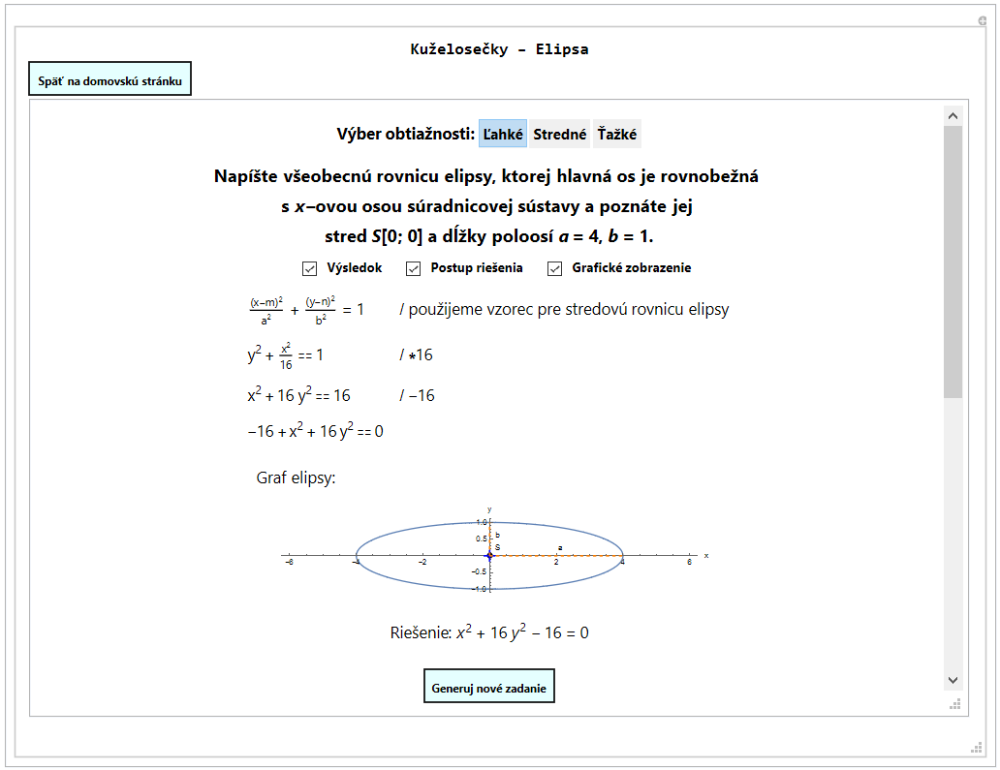
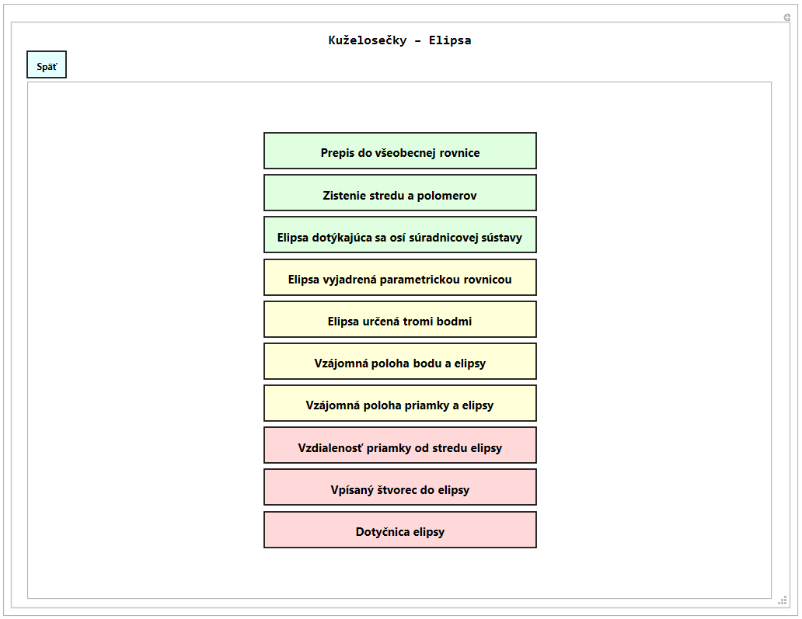
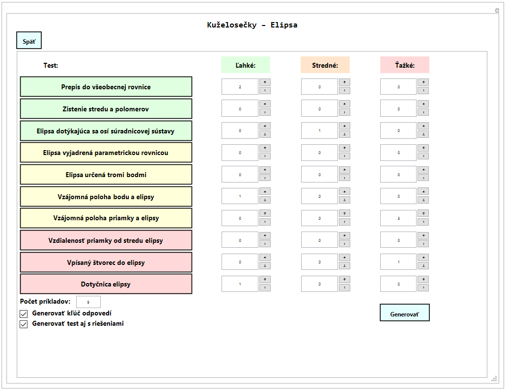
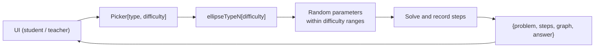

# [Bachelor's Thesis - Conic Sections Problem Generator](https://github.com/AkosKappel/BP-ConicShapes)

Author: **Ákos Kappel**

Thesis Title: **Problem generator for analytical geometry in the plane: conic sections**
(*Generátor úloh z analytickej geometrie v rovine: kužeľosečky*)

Study Programme: **Computer Science**

Year: **2019 - 2022**

Supervisor: **Milada Omachelová**

Institution: **Faculty of Informatics and Information Technologies, Slovak University of Technology in Bratislava**

Full text: [Central Register of Theses (CRZP)](https://opac.crzp.sk/?fn=detailBiblioForm&sid=4F55101800366CEF5AFDC4DB109A) (in Slovak)




## Contents

1. [Introduction](#introduction)
2. [Features](#features)
3. [Problem types](#problem-types)
4. [Example](#example)
5. [Running the generator](#running-the-generator)
6. [How it works](#how-it-works)
7. [Credits](#credits)


## Introduction

A [Wolfram Mathematica](https://www.wolfram.com/mathematica/) tool that generates practice problems about ellipses for high school and first-year university students.
Every problem is randomly generated, comes in three difficulty levels and includes a **worked, step-by-step solution**, a plot of the ellipse and the final answer.
Teachers can assemble whole tests from any mix of problem types and difficulties and export them with or without solutions.

From the thesis abstract:

> The goal of this bachelor's thesis is to create a tool that students can use to learn and practise mathematical problems on conic sections, specifically ellipses.
> The tool should generate several types of problems with different levels of difficulty, and it should also show users how the generated problems can be solved.
> We first cover the basic theory and equations of the ellipse, design a simple and easy-to-use interface and choose which problem types the generator should offer.
> We then propose solutions for generating the selected types of problems, implement the tool in Wolfram Mathematica, test it for errors and check the correctness of its output.
> Finally, we describe the strengths and weaknesses of the final version of the generator.

The interface and all generated text are in Slovak, the language the course was taught in.


## Features

- **10 problem types**, each in an *easy*, *medium* and *hard* variant.
- **Step-by-step solutions** written the way a student would solve the problem on paper, including the operation applied on each line (`/ *16`, `/ -16`, `/ :2`).
- **Plots** of the ellipse with its centre, semi-axes and any lines, points or squares from the problem.
- **"Nice" numbers**: parameters are chosen so that results are integers or simple fractions, and ellipses are neither almost circles nor too flat.
- **Student mode**: pick a problem type, choose a difficulty and toggle the answer, the solution steps and the plot.
- **Teacher mode**: set how many problems of each type and difficulty a test should have (up to 100), generate unique problems with a progress bar, and export the test with an answer key or with full solutions.

| Student: problem types | Teacher: test builder |
|:---:|:---:|
|  |  |


## Problem types

| # | Problem type | Easy | Medium | Hard |
|---|---|---|---|---|
| 1 | General equation from the centre and semi-axes | Centre at [0; 0] | Shifted centre | Given the eccentricity instead of one semi-axis |
| 2 | Centre and semi-axes from the general equation | Centre at [0; 0] | Shifted centre | Also compute the eccentricity |
| 3 | Ellipse touching both coordinate axes | Both touching points given | One point from a line equation | Both points from line equations |
| 4 | Ellipse from parametric equations | Centre at [0; 0] | Shifted centre | Equations not in their basic form |
| 5 | Ellipse through three points | Centre at [0; 0] | Centre lies between two of the points | Shifted centre |
| 6 | Position of a point relative to the ellipse | On or off the ellipse | Inside, on or outside | Point is the intersection of two lines |
| 7 | Position of a line relative to the ellipse | Centre at [0; 0] | Shifted centre | Line given by two points |
| 8 | Distance of a line from the centre | Centre form | General form | General form, line given by two points |
| 9 | Square inscribed in an ellipse | Centre at [0; 0] | Shifted centre | Also compute the area |
| 10 | Tangents through a point outside the ellipse | Touching point given | Line through both touching points given | Line through the touching points unknown |

For problems 6 and 7 every outcome (inside/on/outside, secant/tangent/non-secant) is equally likely.


## Example

An *easy* problem of type 1, as shown in the screenshot at the top:

> Write the general equation of an ellipse whose major axis is parallel to the *x*-axis, with centre *S*[0; 0] and semi-axes *a* = 4, *b* = 1.

The generated solution:

| Step | Operation |
|---|---|
| $\dfrac{(x-m)^2}{a^2} + \dfrac{(y-n)^2}{b^2} = 1$ | use the centre form of the ellipse |
| $\dfrac{x^2}{16} + y^2 = 1$ | $\cdot\,16$ |
| $x^2 + 16y^2 = 16$ | $-\,16$ |
| $x^2 + 16y^2 - 16 = 0$ | answer |


## Running the generator

The whole project is one notebook, [`generator.nb`](./generator.nb), written in Mathematica 12.3.

1. Open `generator.nb` in [Wolfram Mathematica](https://www.wolfram.com/mathematica/) 12.3 or newer, or upload it to the [Wolfram Cloud](https://www.wolframcloud.com/) (a free account is enough).
2. Run **Evaluation > Evaluate Notebook**.
3. The last cell, `ellipseProblemGenerator`, renders the app. Choose **Študent** to practise or **Učiteľ** to build a test.

Each problem type is also a plain function that can be called on its own. It returns the problem statement, the solution steps, the plot and the answer:

```wolfram
{problem, steps, graph, answer} = ellipseType7["hard"];
ellipseType1["easy", True]  (* True prints debug output *)
```


## How it works

The notebook has one section per problem type and a UI section that ties them together.
Each `ellipseTypeN[difficulty]` function is a self-contained `Module` that picks random parameters, builds the problem statement, records the solution steps while it solves the problem, and plots the result.
The snippets below are taken from the notebook and reformatted for reading.



### Difficulty sets the parameter ranges

Each difficulty maps to ranges for the centre and the squared semi-axes. A range is picked at random first, then a value inside it, which keeps the centre away from zero for the harder levels.

```wolfram
setDifficultyParameters[] := Block[{},
  Which[
    MemberQ[{"lahke", "easy"}, ToLowerCase[problemDifficulty]], difficulty = 1,
    MemberQ[{"stredne", "medium"}, ToLowerCase[problemDifficulty]], difficulty = 2,
    MemberQ[{"tazke", "hard"}, ToLowerCase[problemDifficulty]], difficulty = 3];
  Switch[difficulty,
    1, centerRanges = {{0, 0}};           radiusSquaredRanges = {{1, 16}},
    2, centerRanges = {{-3, -1}, {1, 3}}; radiusSquaredRanges = {{1, 16}},
    3, centerRanges = {{-5, -1}, {1, 5}}; radiusSquaredRanges = {{1, 20}}];
];

(* select random integer from list of ranges *)
randInt[ranges_] := RandomInteger[RandomChoice[ranges]];

aSquared = randInt[radiusSquaredRanges]; bSquared = randInt[radiusSquaredRanges];
m = randInt[centerRanges]; n = randInt[centerRanges];
```

### Keeping the ellipse readable

Random semi-axes can produce an ellipse that looks like a circle or a flat line, which makes a poor exercise and a poor plot. The difference between $a^2$ and $b^2$ is clamped:

```wolfram
prettifyEllipseParamaters[] := Block[{minSquaredDifferenceAB = 4, maxSquaredDifferenceAB = 25},
  (* do not let 'a' and 'b' be too similar (final ellipse looks like a circle) *)
  If[Abs[aSquared - bSquared] < minSquaredDifferenceAB,
    If[aSquared <= minSquaredDifferenceAB && bSquared <= minSquaredDifferenceAB,
      If[aSquared > bSquared, aSquared = bSquared + minSquaredDifferenceAB, bSquared = aSquared + minSquaredDifferenceAB],
      If[aSquared < bSquared, aSquared = bSquared - minSquaredDifferenceAB, bSquared = aSquared - minSquaredDifferenceAB]]];
  (* do not let 'a' and 'b' differ too much (it creates flat ellipses) *)
  If[Abs[aSquared - bSquared] > maxSquaredDifferenceAB,
    If[aSquared > bSquared, aSquared = bSquared + maxSquaredDifferenceAB, bSquared = aSquared + maxSquaredDifferenceAB]];
];
```

### From the centre form to the general form

Expanding $\frac{(x-m)^2}{a^2} + \frac{(y-n)^2}{b^2} = 1$ gives the coefficients of $Ax^2 + By^2 + Cx + Dy + E = 0$ directly. Dividing by their greatest common divisor gives the simplest integer form, which is the expected answer.

```wolfram
initGeneralFormCoefficients[simplifyToBase_:True] := (
  valA = bSquared;
  valB = aSquared;
  valC = -2*m*valA;
  valD = -2*n*valB;
  valE = valA*m^2 + valB*n^2 - valA*valB;
  If[TrueQ[simplifyToBase],
    gcd = GCD[valA, valB, valC, valD, valE];
    If[gcd != 1, valA /= gcd; valB /= gcd; valC /= gcd; valD /= gcd; valE /= gcd]];
);
```

### Recording the solution while solving

The solver works on a real Mathematica equation and appends each intermediate form to `steps`, together with the operation that leads to the next line. This is how the solution reads like hand-written work instead of a single `Solve` result.

```wolfram
(* add new step into step by step solution, skipping duplicates *)
appendStep[step_] := If[prevStep =!= step, AppendTo[steps, step]; prevStep = step];

(* subtract right side of equation *)
If[eq[[2]] > 0,
  AppendTo[steps[[Length[steps]]], StringForm["/ -``", eq[[2]]]];
  eq = SubtractSides[eq, eq[[2]]];
  appendStep[{eq // DisplayForm}]];

(* simplify equation into base form if necessary *)
gcdVal = GCD @@ List @@ eq[[1]] /. {x -> 1, y -> 1};
If[gcdVal != 1,
  AppendTo[steps[[Length[steps]]], StringForm["/ :``", gcdVal]];
  appendStep[{answer // DisplayForm}]];
```

### Searching for "nice" ellipses

Several problem types need ellipses that pass through points with integer coordinates, so that intersections and touching points can be computed by hand. These semi-axes are found once by brute force over the integers and stored, because the search is slow:

```wolfram
(* NOTE: takes long time to execute, so generate only once and save into variable for later use *)
generateNiceRadiuses[minLength_:1, maxLength_:100, minNumberOfIntegerPoints_:6] :=
  Block[{radiuses = List[], lengthA, lengthB, sols},
    For[lengthA = minLength, lengthA <= maxLength, lengthA++,
      For[lengthB = lengthA + 1, lengthB <= maxLength, lengthB++,
        sols = Solve[{x^2/lengthA + y^2/lengthB == 1}, {x, y}, Integers];
        If[Length[sols] >= minNumberOfIntegerPoints, AppendTo[radiuses, {lengthA, lengthB}]]]];
    Return[radiuses]];

(* saved pregenerated values from generateNiceRadiuses[] *)
niceSquaredRadiuses = {{4, 12}, {5, 20}, {9, 18}, {10, 40}, {12, 16}, {12, 36}, {18, 36}};
```

### Generating a tangent with sampling

For problem type 7 the generator first decides the answer (secant, tangent or non-secant) and then builds a line that produces it. For a tangent it picks an integer point on the ellipse, takes the tangent through it, and retries until the line's intercept stays small enough to be readable:

```wolfram
tangentThroughPoint[pointA_] := (
  If[pointA[[2]] - n != 0,
    k = -(b^2*(pointA[[1]] - m))/(a^2*(pointA[[2]] - n)); q = pointA[[2]] - k*pointA[[1]],
    k = Infinity; q = Null];
  Simplify[b^2*(pointA[[1]] - m)*(x - m) + a^2*(pointA[[2]] - n)*(y - n) - a^2*b^2 == 0]);

randomPointForTangent[] := Block[{onPoints, selectedPoint, qConstraint = 10, numTries = 0, maxTries = 1000},
  onPoints = {x, y} /. Solve[{(x - m)^2/a^2 + (y - n)^2/b^2 == 1,
      m - a <= x, x <= m + a, n - b <= y, y <= n + b}, {x, y}, Integers];
  While[numTries < maxTries, numTries++;
    selectedPoint = RandomChoice[onPoints];
    tangentThroughPoint[selectedPoint];
    If[TrueQ[-qConstraint <= q] && TrueQ[q <= qConstraint], Return[selectedPoint]]];
  Print[Style["ERROR: cannot generate points for tangent", Red]];
];
```

### Connecting the generators to the UI

`Picker` dispatches a problem type and difficulty to its generator. The interface, built with `Manipulate` and `DynamicModule`, calls it whenever the user asks for a new problem:

```wolfram
Picker[string_, typ_, narocnost_] := Switch[typ,
  1, ellipseType1[narocnost],
  2, ellipseType2[narocnost],
  (* ... *)
  10, ellipseType10[narocnost]
];

Button[Style["Generuj nové zadanie", FontWeight -> Bold, FontSize -> 14],
  genZadanie = Picker["", typ, narocnost],
  Background -> LightCyan, ImageSize -> {160, 40}]
```


## Credits

The ten problem generators, their solution steps and plots are my work.
The graphical interface is adapted from the bachelor's thesis of **Kristína Čopíková** (FIIT STU), and the test generation and export from the bachelor's thesis of **Róbert Szabó** (FIIT STU).
The changes made to both are listed in the *UI* section of the notebook.
